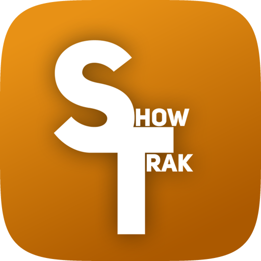

# ShowTrak Timers

**Show timers run from the desk, a Stream Deck, QLab or any browser.**

[Website](https://showtrak.co.uk/software/timers) · [Download](https://showtrak.co.uk/software/timers/downloads) · [Documentation](https://showtrak.co.uk/docs/timers) · [Discord](https://discord.gg/DACmwsbSGW)

[![Windows][badge-windows]](https://showtrak.co.uk/software/timers/downloads) [![macOS][badge-macos]](https://showtrak.co.uk/software/timers/downloads) [![Linux][badge-linux]](https://showtrak.co.uk/software/timers/downloads) [![Raspberry Pi][badge-raspberrypi]](https://showtrak.co.uk/software/timers/downloads)

ShowTrak Timers runs the clocks for your show: walk-in countdowns, act timers, changeover
stopwatches. Control them from the app or over OSC, and put them on any phone or backstage screen
on the network.

## Key features

- **Timers, countdowns and stopwatches**: kept to the clock, so they never drift, with optional hundredths of a second.
- **Endings and warnings**: at the end, stop, keep counting into overrun in red, reset or start again. Add a warning before the end with its own sound and notification, using the built-in sounds or your own.
- **Groups**: colour-coded groups you can select with a number key and start, pause or stop together.
- **OSC control**: start, stop, pause, rename and set timers, groups or everything at once from QLab, Bitfocus Companion or any OSC sender.
- **Web Dashboard**: show timers on any phone, tablet or backstage screen, with a QR code to open it and an optional passcode.
- **Built for live shows**: Show and Edit modes, keyboard shortcuts, and starting a selection never restarts a timer that is already running.
- **Show files**: keep each show in its own `.showtraktimers` file, with autosave.
- **Safe updates**: Stable or Beta channel, and updates never restart the app mid-show.

## Getting started

1. [Download ShowTrak Timers](https://showtrak.co.uk/software/timers/downloads) and install it.
2. Switch to Edit mode and add your timers.
3. Open the Web Dashboard on any device, or send OSC from your show control.

The [ShowTrak Timers guide](https://showtrak.co.uk/docs/timers) lists every OSC command.

## Part of ShowTrak

| App                                                           | What it does                                                                |
| ------------------------------------------------------------- | --------------------------------------------------------------------------- |
| **[ShowTrak Server](https://showtrak.co.uk/software/server)** | Monitor and control every computer and show device from one screen.         |
| **[ShowTrak Client](https://showtrak.co.uk/software/client)** | The lightweight app that lets ShowTrak Server watch and control a computer. |
| **[ShowTrak Timers](https://showtrak.co.uk/software/timers)** | Show timers run from the desk, a Stream Deck, QLab or any browser.          |
| **[ShowTrak Portal](https://showtrak.co.uk)**                 | Show reports, schedules and team collaboration for live productions.        |

Find everything at **[showtrak.co.uk](https://showtrak.co.uk)**.

## Support

Questions, ideas or problems? Join the [ShowTrak Discord](https://discord.gg/DACmwsbSGW) or [open an issue](https://github.com/ShowTrak/ShowTrakTimers/issues).

## Licence

ShowTrak Timers is free and open source under the [GNU AGPL-3.0](LICENSE).

Building from source or contributing? See [DEVELOPMENT.md](DEVELOPMENT.md).

[badge-windows]: https://img.shields.io/badge/Windows-0078D4?style=for-the-badge&logo=data:image/svg%2bxml;base64,PHN2ZyB4bWxucz0iaHR0cDovL3d3dy53My5vcmcvMjAwMC9zdmciIHZpZXdCb3g9IjAgMCAyNCAyNCI%2BPHBhdGggZmlsbD0iI2ZmZiIgZD0iTTAgMy40NDkgOS43NSAyLjF2OS40NTFIMG0xMC45NDktOS42MDJMMjQgMHYxMS40SDEwLjk0OU0wIDEyLjZoOS43NXY5LjQ1MUwwIDIwLjY5OU0xMC45NDkgMTIuNkgyNFYyNGwtMTIuOS0xLjgwMSIvPjwvc3ZnPg%3D%3D
[badge-macos]: https://img.shields.io/badge/macOS-000000?style=for-the-badge&logo=apple&logoColor=white
[badge-linux]: https://img.shields.io/badge/Linux-FCC624?style=for-the-badge&logo=linux&logoColor=black
[badge-raspberrypi]: https://img.shields.io/badge/Raspberry%20Pi-A22846?style=for-the-badge&logo=raspberrypi&logoColor=white
